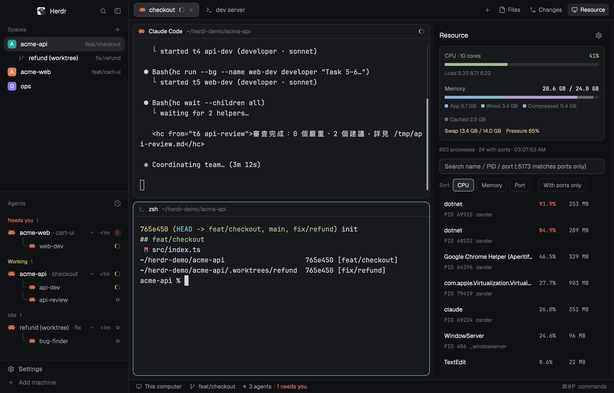

# herdr-agent-team

一個人帶一組 AI agent 寫程式的 [Herdr](https://herdr.dev) 工作環境：
**一個 lead agent 規劃、用 `hc` 派工給固定角色的 agent（developer／reviewer／tester／fixer／bug-finder），
人在一個視窗裡看所有 agent 的狀態。**

這個 repo 包含三樣東西，可以分開取用：

| 部分 | 路徑 | 裝到哪裡 | 用途 |
|---|---|---|---|
| Team（角色 template） | `templates/*.md` | `~/.config/herdr-core/templates/` | `hc run --bg <角色> "<任務>"` 派出的 agent |
| Layout | `layouts/agent-team.json` + `mods/agent-team-tabs/` + `mods/resource-monitor/` | `~/.config/herdr-app/` | 左邊 spaces／agents、中間 pane 卡片、右側可切換 Files／Changes／Resource |
| 按鍵 | `keys.json` | 合併進 `~/.config/herdr-app/keys.json` | macOS `cmd` 系快捷鍵 |



---

## 安裝

最簡單：在 Herdr 視窗裡跟 agent 說

> Add the layout github.com/chuangmaster/herdr-agent-team, and install its hc templates.

手動：

```sh
git clone https://github.com/chuangmaster/herdr-agent-team
cd herdr-agent-team

# 1. Team：hc 角色 template
mkdir -p ~/.config/herdr-core/templates
cp -n templates/*.md ~/.config/herdr-core/templates/
hc templates                       # 應列出 bug-finder / developer / fixer / reviewer / tester

# 2. Layout 與它需要的 mod（已存在同名就先改名，不要覆蓋）
cp -n layouts/agent-team.json ~/.config/herdr-app/layouts/
cp -Rn mods/agent-team-tabs mods/resource-monitor ~/.config/herdr-app/mods/
herdr-app check ~/.config/herdr-app/mods/agent-team-tabs
herdr-app check ~/.config/herdr-app/mods/resource-monitor
herdr-app do layout.switch --name agent-team

# 3. 按鍵（選用）：手動把 keys.json 的內容合併進自己的，不要整份覆蓋
```

`resource-monitor` 是獨立發布的 mod（[chuangmaster/herdr-resource-monitor](https://github.com/chuangmaster/herdr-resource-monitor)），
這裡附一份讓 layout 能直接用；它會執行本機的 `ps`、`lsof`、`kill` 等程式，不連網。

---

## 設計原理

### 1. 結構對應：Space／Tab／Pane／Worktree 各管一層

Herdr 的四層結構，各自對應一個「工作的單位」，原則是**越上層越長壽、越下層越短命**：

| 層 | 對應 | 壽命 | 實際例子 |
|---|---|---|---|
| **Space** | 一個 repo，或一個主題 | 數週 | `real-you-back-end`、`real-you-front-end`、`Railway相關`、`學herdr` |
| **Tab** | 一件正在做的事（一個 lead agent 一條對話） | 數小時～數天 | tab 1 = Claude Code（lead），tab 2 = 純 shell（dev server、git） |
| **Pane** | 同一件事需要並排看的終端機 | 隨 tab | agent 旁邊切一個 shell 跑測試、看 log |
| **Worktree** | 同一個 repo 裡**同時**進行的另一條 branch | 一個功能 | `.worktrees/external-login` |
| **Sub-agent** | lead 用 `hc run` 派出的角色 agent | 一個任務 | `developer`、`reviewer`，沒有自己的 pane，掛在 lead 的 tab 底下 |

幾個刻意的選擇：

- **Space 依 repo 切，不依功能切。** 前後端分屬不同 repo，各自一個 space；sidebar 每列會顯示該 space 的 branch，
  一眼看出各 repo 現在在哪條 branch。不屬於任何 repo 的雜事（部署、學工具）就開一個有名字的主題 space。
  每個 space 會自動分配一個不重複的顏色（Herdr 內建 `spaces` mod 的行為），切換時不會看錯 repo。
- **Tab 就是一條 lead 對話。** 不在同一個 tab 裡塞兩個 lead agent——agent 的狀態（working／blocked／done）
  會冒泡到 tab 和 space，一個 tab 一個 lead，狀態點才有意義。
- **Sub-agent 不佔 pane。** 用 `hc run --bg` 派出的 agent 記錄 lead 為 parent，出現在左下 Agents 清單、
  縮排在 lead 底下；想看就 `terminal.peek`（或 Cmd-click 終端機裡的位址），不需要時不佔畫面。
- **Pane 一律是卡片（`lone: true`）。** 就算只有一個 pane 也有 header 和邊框，header 顯示程式與目前資料夾，
  所以一眼看得出這個終端機現在在哪個 worktree。

### 2. Worktree：同 repo 平行，才需要它

派工時的判斷（也是 lead agent 被要求遵守的規則）：

| 情況 | 做法 | 原因 |
|---|---|---|
| 不同 repo 的任務 | 直接並行，各派一個 developer | 檔案不會互相衝突 |
| 同 repo、有相依或會改同一批共用檔案 | **交給同一個 agent 依序做** | 例如 `Program.cs` 的 DI 註冊、錯誤碼常數，平行改一定衝突 |
| 同 repo、真的獨立的兩條 branch | 開 worktree，`hc run --cwd <worktree>` | 各自的工作目錄，互不干擾 |

Worktree 放在兩種地方，都可以：

- **repo 內 `.worktrees/<名稱>`**（要加進 `.gitignore`）——agent 自己用 `git worktree add` 開，
  派出的 agent 以 `--cwd` 指到那裡；不另開 space，從 pane header 的路徑分辨。
- **Herdr 的 worktree mod**（space 右鍵 → New worktree）——放在 `~/.herdr/worktrees/<repo>/<branch>`，
  自動變成一個新 space，在 sidebar 巢狀顯示在原 repo 底下，並顯示 ahead/behind 與未提交變更。
  適合要長時間由人親自操作的 branch。

### 3. Team：角色 template 的設計

`templates/` 裡每個檔案是一個 hc template：frontmatter 定義 `name`、`description`、`command`（含模型），
本文是角色指令；派工時 hc 會把「角色指令 + 你的任務」合成第一則訊息送出。

| 角色 | 模型 | 能改檔案？ | 職責 |
|---|---|---|---|
| `bug-finder` | opus | 否（唯讀） | 找根因，回報 `檔案:行號`、重現步驟、修正方向 |
| `fixer` | sonnet | 是，只改指定範圍 | 依根因修正，跑快速驗證 |
| `developer` | sonnet | 是 | 依 spec／plan 實作功能＋單元測試 |
| `tester` | haiku | 只改測試檔 | 補測試、執行、判讀 |
| `reviewer` | opus | 否（唯讀） | 審查 diff，依嚴重度回報 |

設計原則：

- **判斷用強模型，產出用中模型，例行用小模型。** 找根因與審查需要的是判斷力，錯了代價最高，用 opus；
  寫程式量大但規格已定，用 sonnet；測試撰寫與執行最機械化，用 haiku 省成本。
- **讀寫分離。** `bug-finder`、`reviewer` 一律唯讀；`fixer`／`tester` 只能改被授權的範圍。
  「調查的人不動手、動手的人不自己驗收」，lead 才能拿兩份獨立的結論互相對照。
- **每個角色都「不啟動其他 agent」、「不 commit／push／切 branch」。** 派工樹只有一層，
  git 狀態只由 lead（與人）決定，避免 agent 互相派工失控或在錯的 branch 上提交。
- **專案規則不寫進 template。** template 只說「遵守該專案 CLAUDE.md／AGENTS.md」，
  測試範圍、程式碼風格等交給各 repo 自己的文件——同一組角色可以用在任何專案。
- **回報格式固定。** 每個角色都規定回報要列哪幾項（改了什麼、驗證結果照實寫、需要人確認的事），
  lead 收到後可以直接彙整，不用再追問。

### 4. 一次典型的派工流程

```sh
# lead（在 tab 1 的 Claude Code）寫完計畫後：
hc run --bg --name be-dev --cwd ~/Repository/my-back-end  developer \
  "依 docs/plans/xxx.md 的 Task 1–4 實作。完成或卡住時用 hc send $HC_TERMINAL_ID 回報。"
hc run --bg --name fe-dev --cwd ~/Repository/my-front-end developer \
  "依 docs/plans/xxx.md 的 Task 5–6 實作。完成或卡住時用 hc send $HC_TERMINAL_ID 回報。"

hc wait --children all            # 不輪詢；agent 回報會以 <hc from="..."> 送回 lead

hc run --bg --name be-review --cwd ~/Repository/my-back-end reviewer \
  "審查目前 branch 相對 dev 的變更。結果寫到 /tmp/be-review.md，用 hc send 回報路徑。"
```

畫面上：左下 Agents 清單出現 `be-dev`、`fe-dev` 縮排在 lead 底下，轉圈＝working、
圓點＝blocked（需要人介入，例如權限確認）或 done（顏色取自主題的 `blocked`／`done`）；有人需要你時會播音效並跳通知，點通知直接跳過去。

在 lead 的 Claude Code 裡，可以直接說「使用 herd team 實作」讓它照這個流程走
（建議把這個用語寫進你的 CLAUDE.md 或記憶，讓 agent 知道它代表 `hc run --bg <template>`，而不是內建 subagent）。

### 5. Layout

```
┌──────────────┬───────────────────────────────────────────────┐
│ Herdr  🔍 ▣   │ [tab 1 ⟳] [tab 2]          +  Files Changes Resource │ ← agent-team-tabs (42px)
│ Spaces     + │ ┌──────────────────────────┐ ┌──────────────┐ │
│ ● back-end   │ │ Claude Code ~/repo   ⊟⊞✕ │ │ Files /      │ │
│ ● front-end  │ │                          │ │ Changes /    │ │
│ ● Railway相關│ │   pane 卡片（圓角 10、   │ │ Resource     │ │
│──────────────│ │   gap 8、focus 邊框）    │ │ (368px, 可藏)│ │
│ Agents       │ │                          │ │              │ │
│  lead ⟳      │ └──────────────────────────┘ └──────────────┘ │
│   └ be-dev ⟳ │                                               │
│ Settings     │ This computer · branch · N agents             │ ← workspace-status (28px)
└──────────────┴───────────────────────────────────────────────┘
   268px
```

由 Herdr 預設的 `main` layout 複製而來，改了三處：

1. **Tab bar 換成 `agent-team-tabs`**：在 Files／Changes 旁加一顆 **Resource** 按鈕，開關右側的資源監控面板。
   右側面板開哪一個是**每個 space 各自記住**的（切到前端 space 可能開著 Changes、後端 space 關著）。
2. **右側面板的 stack 多一個 `processes` 子節點**，放 `resource-monitor` mod：多個 agent 同時跑 build／dev server 時，
   用來找出吃 CPU 的 process 和佔住的 port，直接終止。
3. **Pane 一律是有 header 的卡片**（`lone: true`、header 常駐、圓角 10、間距 8），
   header 有分割／放大／關閉按鈕。

### 6. 按鍵（`keys.json`，macOS）

| 範圍 | 按鍵 | 動作 |
|---|---|---|
| Space | `ctrl-1`…`9`、`cmd-alt-[` / `]`、`cmd-n` | 跳到第 N 個 space、上／下一個、新 space |
| Tab | `cmd-1`…`9`、`cmd-shift-[` / `]`、`cmd-t`、`cmd-w` | 跳到第 N 個 tab、上／下一個、新增、關閉 |
| Agent | `cmd-[` / `]` | 依 Agents 清單順序跳到上／下一個 agent（巡視整個 team 最快的方式） |
| Pane | `cmd-d` / `cmd-shift-d`、`cmd-alt-方向`、`cmd-alt-shift-方向`、`cmd-shift-enter`、`cmd-shift-w` | 右／下分割、移動焦點、交換位置、放大、關閉 |
| 其他 | `cmd-p`、`cmd-shift-p`、`cmd-b`、`cmd-shift-l`、`f2` / `shift-f2` | picker、指令面板、收合 sidebar、切換 layout、改 tab／space 名稱 |
| 終端機 | `alt-←/→`、`cmd-←/→`、`cmd-backspace`、`ctrl-v` | 逐字移動、行首行尾、刪整行、貼上圖片給 agent |

`"ctrl-,": "send:，"` 是給中文輸入的個人設定（送出全形逗號），不需要可以刪掉。

---

## 授權

MIT
