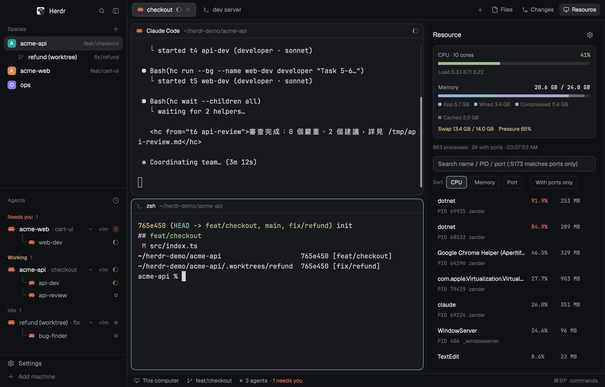

# Agent Team

A Herdr window for one person running a small team of coding agents. Spaces
(one per repo) and the agents list, with sub-agents indented under the agent
that started them, sit on the left. Every pane is a card with a header. The
tab bar has Files, Changes and Resource buttons that open a right-hand panel,
remembered per space. It ships with five `hc` role templates
(developer, reviewer, tester, fixer, bug-finder) that a lead agent dispatches
with `hc run --bg <role> "<task>"`.

## What you see

Left to right:

1. **Sidebar** (`sidebar`, 268px, min 44, max 480, background `chrome`, not
   drag-resizable), top to bottom:
   - `brand` (46px, `window_drag`): the shipped `workspace-chrome` header
     (Herdr mark, search, sidebar toggle). macOS traffic lights at `[12, 16]`.
   - `sidebar-lists`: `spaces` and `agents` (shipped mods), weight 1 each,
     min 90 each. Spaces show name, branch, and an auto-assigned color.
     Agents are grouped by space; sub-agents are indented under their parent.
   - `sidebar-footer` (69px): `workspace-chrome` with `props: {footer: true}`
     (Settings, Add machine).
2. **Work column** (`work`, not drag-resizable):
   - `tabs` (42px, `window_drag`): the `agent-team-tabs` mod. Tab pills
     (29px high, radius 7, 12.8px text, program icon, name, spinner while
     working, a 6px dot for blocked/done, close × on the active pill), then
     `+` (opens the shipped `new-menu`), then panel buttons: Files, Changes
     (only when listed in shared `"workspace.panels"`, default both), and
     Resource (shown whenever the layout has a `processes` node).
   - `work-body` (row, padding 8, gap 8):
     - `main`: `{ "tab": "active" }`, panes as cards: background
       `background`, 1px `border`, 1px `accent` on focus, radius 10, gap 8,
       `lone: true`, header = shipped `pane` mod, 30px, top, always shown.
     - `panel` (368px, min 280, max 900, hidden by default) → `panel-body`
       stack with `files`, `changes`, `processes` (`resource-monitor`).
   - `status` (28px): shipped `workspace-status` (machine, branch, agent
     count, command palette hint).

Root: row, background `canvas`, `terminal_padding: [14, 12]`, 1px `border`
divider, `titlebar: "none"`. No theme of its own (follows settings; the
author uses `{light: paper, dark: graphite}`).

## How it behaves

- Agent status shows in three places: the tab pill (spinner for `working`,
  `t.blocked` / `t.done` dot), the Agents list, and the pane header.
  `idle` shows nothing.
- Tab pills: click selects, double-click renames, drag onto another pill
  reorders (`tab.move`), right-click opens the shipped `menu` for that tab,
  scroll wheel over the bar goes to the previous/next tab.
- Panel buttons toggle the right panel: clicking the active one hides it;
  another one selects that stack child and shows the panel. The open panel
  (or none) is stored per space in the mod's `localStorage` and restored
  when switching spaces.
- `cmd-[` / `cmd-]` walk agents in the Agents list order (`agent.prev/next`).
- Team: a lead agent runs
  `hc run --bg --name <n> --cwd <repo or worktree> <role> "<task>"`;
  the child appears under it in Agents, reports back with `hc send`.

## Built from

- Layout `layouts/agent-team.json`, cloned from shipped `main` (0.1.13).
  Differences from `main`: tabs block uses `agent-team-tabs`; `panel-body`
  stack has a third child `processes` → `resource-monitor`; pane frame has a
  header (`pane` mod) and `lone: true`.
- `mods/agent-team-tabs`: clone of shipped `tabs` with one change — the
  enabled panel list appends `"processes"` when `find(layout(), "processes")`
  exists, and a third `panelButton("processes", "Resource",
  "mods/workspace-chrome/monitor.svg")`. Windows buttons use its own
  `win-*.svg`. Uses `spaces`, `panes`, `run`, `openOverlay`, `theme`,
  `window`, `shared`, `layout`, `settings`; commands `tab.select`,
  `tab.move`, `tab.rename`, `tab.close`, `tab.prev`, `tab.next`,
  `layout.select`, `layout.show`, `layout.hide`, window commands.
- `mods/resource-monitor`: published separately at
  github.com/chuangmaster/herdr-resource-monitor (CPU/memory/processes/ports,
  terminate/kill). Runs `ps`, `lsof`, `vm_stat`, `sysctl`, `kill` on macOS.
- Shipped mods used as-is: `workspace-chrome`, `spaces`, `agents`, `pane`,
  `files`, `changes`, `workspace-status`, `new-menu`, `menu`.
- `templates/*.md` → `~/.config/herdr-core/templates/`: frontmatter
  `name`, `description`, `command` (`claude --model opus|sonnet|haiku`), body
  = role instructions. bug-finder and reviewer are read-only; fixer edits
  only the assigned scope; tester edits only tests; developer implements
  with unit tests. None may commit, push, switch branches or start agents.
- `keys.json`: optional macOS bindings (`cmd-[`/`]` agents, `ctrl-1..9`
  spaces, `cmd-1..9` tabs, `cmd-d` splits, `cmd-alt-arrows` pane focus).

## Watch out

- `herdr-app check` and the layout reference `agent-team-tabs` and
  `resource-monitor` by folder name; rename both the folder and the layout's
  `content.mod` together if either name is taken.
- The tab mod's SVG paths are `mods/agent-team-tabs/...`; a renamed folder
  must rewrite them.
- If shared `"workspace.panels"` is `[]` (the welcome screen sets it), only
  Resource shows; Files/Changes come back when that list includes them.
- Templates assume Claude Code is installed as `claude`; change `command`
  for other agents. They tell agents to follow each repo's
  CLAUDE.md / AGENTS.md rather than embedding project rules.
- `keys.json` uses `cmd-` (macOS). Merge it; don't overwrite a personal file.
  `"ctrl-,": "send:，"` is a personal full-width-comma binding.

## Done when

- `herdr-app check` passes for `mods/agent-team-tabs` and
  `mods/resource-monitor`, and `layout.switch {name: "agent-team"}` shows
  the window above with no entry in `herdr-app status` errors.
- Clicking Resource opens the process list on the right; clicking it again
  hides the panel; switching to another space and back restores it.
- `hc templates` lists the five roles, and
  `hc run --bg --name r reviewer "say hi, no edits"` starts an agent that
  shows indented under the caller in the Agents list.
